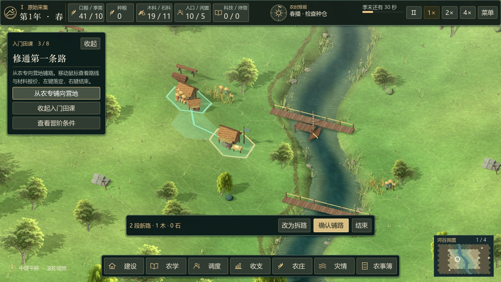
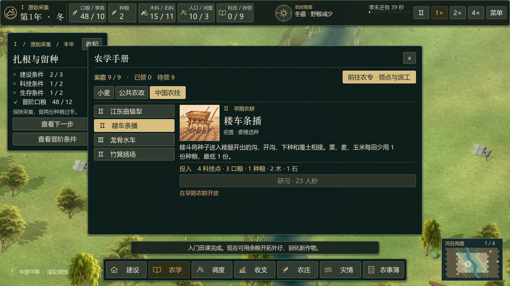

# 稻生江畔

**[下载 V1.00 正式版 · Windows x64](https://github.com/Imngenesis/TimeofAgriculture-AgricultureBall/releases/download/v1.0.0/RiceByTheRiver-Windows-x64.zip)**。完整解压，双击「稻生江畔.exe」即可离线游玩。[正式版发行说明](https://github.com/Imngenesis/TimeofAgriculture-AgricultureBall/releases/tag/v1.0.0)

带十名居民从采集走向现代农业。你可以把雨季的口粮拿去招募，留下来育种，也可以换成把农专接到第一块田的木料。每季 40 个游戏秒，可随时暂停派工。



## 第一块田

新战役会开启八步入门田课。点左侧当前任务可直接定位设施或进入选址，进度由实际操作推进，读档可以接着做。可随时收起，再按 **J** 打开。

1. 给野粮采集地派两人，再在空地建农专。施工用人手，建成后农专是路网起点。
2. 按 **G** 进入铺路模式，点击起点，移动鼠标看线路和用料，点击终点落定。可以从上一段继续铺，右键结束。也可点断路建筑里的「接入农专」，看过报价后确认。每次每两段新路用 1 木，不足两段按 1 木计，经过桥头另需 1 石。已建路段可复用。
3. 给农专派人。合计每 18 人秒编成 1 点札记，必须领取后方可研究。按 **T** 打开农学手册，看所需前置、材料和工时。首项课题随本地作物变化。
4. 建好试验农田并铺路，从口粮中封存种粮，派人照料。春夏播种，秋末按田结算口粮、留种和副产饲料。粮仓、农田、料场、灌渠、秧圃等设施需通路至农专。野外采集与施工可先行。
5. 点击顶栏的口粮、种粮、木石、人手或科技，直接打开相应面板。按 **B** 建设，空格暂停，数字 **1 / 2 / 3** 切换一倍、二倍和四倍速。中键拖动或 WASD 平移，滚轮缩放，点小地图定位。

## 作物、品系与研究

长江湿地和滨海河口以稻开始，萨赫勒以珍珠粟开始，多瑙河以麦开始，安第斯与墨西哥高原分别以马铃薯和玉米开始。荒年随机抽取生态和营址。探险、野外采集带回一种新作物的样本时，该作物的课题页就会出现。进一步的田间课题需要完成驯化。全游戏有 **32 个可研究课题**，其中六条作物分支各有三项专修。

| 原种 | 基础粮 | 每田用种 | 秋收副产饲料 | 收获时地力变化 | 适合的经营选择 |
| --- | ---: | ---: | ---: | ---: | --- |
| 水稻 | 7 | 2 | 0 | −1 | 低地增产，连通灌渠后可发展稻鱼共生 |
| 珍珠粟 | 5 | 1 | 1 | 0 | 投种少，高地与雨养区可靠，后期可兼收饲草 |
| 小麦 | 8 | 2 | 0 | −1 | 台地表现好，耧播节种，本地有粮仓时精收受益 |
| 马铃薯 | 12 | 3 | 0 | −2 | 投种较多，适合高地，窖藏研究能改善分拣收益 |
| 菜豆 | 4 | 1 | 0 | +5 | 收粮较少，适合恢复地力，搭架后照料可换取额外收成 |
| 玉米 | 10 | 2 | 2 | −3 | 粮、饲料双收，连续种植要留意地力 |

表中是地形、品种、年景、照料和灾害结算前的游戏数值。原种、丰穗系和耐逆系可分别留存，并逐田指定下茬。丰穗系每田多用 1 种，丰年有更高的产量上限。耐逆系用种较省，贫瘠、病情或淡水短缺时表现更稳。在田作物沿用播种时的性状。每种作物每季第一次收获会判定自然变异，有利与不利的概率在图鉴中显示。



中国农技包括江东曲辕犁、耧车条播、龙骨水车、竹箕扬场和青田稻鱼共生。它们分别改变田间照料、耗种、灌渠覆盖、谷物收成和灌溉稻田的收益。农具历史介绍参考中国农业博物馆和中国科学技术馆，稻鱼系统参考联合国粮农组织。游戏中的资源折算与产量加成为本作设计。[中国农业博物馆](https://www.ciae.com.cn/detail/zh/31.html) · [中国科学技术馆](https://www.cdstm.cn/museum/zphc/hxzg2017x/art/2017/art_53e94752827344bcbc0a642bab8196bd.html) · [粮农组织的青田稻鱼资料](https://www.fao.org/agroecology/new-knowledge-module/publications/detail/the-globally-important-agricultural-heritage-systems-%28giahs%29-rice-fish-culture-qingtian-county-china/en) · [美术图集与生成提示](docs/art-assets.md)

## 余粮怎么用

- **研究**按课题一次性扣除点数和所列的粮、种、木、石，投入 16 至 40 人秒完成。点数与未领取札记共用案藏容量，一级农专开局合计 9 点。升时代和扩建农专能增加容量。
- **仓储**按地点结算。营地有 48 份口粮仓容，外圩各有 24，每级接通的当地粮仓加 36。种仓随连通农田和粮仓增加，木石料仓也随当地粮仓扩容。货单预占目的地相应仓位。照料的增产逐步递减，野粮每季有采集上限。
- **拓殖**需要两名空闲居民、4 粮和 1 木。32 秒后探险队带回种源。三处外圩各有独立仓库，道路连上农专后，当地居民才能正常生产。小径每批运 4 份，连续道路每批 8 份。可运粮、种、木、石、饲料，也可迁移居民。
- **养殖**可引入鸡、山羊，繁育后收取蛋奶，并用厩肥养地。营地畜栏通路才正常生产。滨海河口另有淡水账，十人携 22 水登陆，集雨池每季多收 6 水。
- **难度与晋阶**。丰年、常年、荒年的开局口粮为 42 / 30 / 24，秋收系数为 115% / 100% / 88%。前三次晋阶分别缴 12 / 20 / 32 粮，同时满足建设、科技和生存条件。四时代每田基础加成为 0 / 2 / 5 / 8，每季常规时代事务费为 0 / 2 / 5 / 8。汛情与梅雨按农时到来，其余危机由技术的实际使用引发。

## 存档与开发

每季、重大预警和晋阶时自动保存，Esc 菜单可手动存读或从时代起点重试。0.1、0.2、0.3 和 V1.00 Beta 1 的存档可直接继续。迁移时保留既有品系、物资、研究、在途队伍和已开发地块。旧档中已有农专的聚落会补接既有设施的道路。存档位置为 `%APPDATA%\RiceByTheRiver`。

用 Godot 4.7.2 标准版打开[工程](desktop/project.godot)，按 F5 运行。安装匹配的 Windows x64 导出模板后可本地打包。

```powershell
.\build-windows.ps1 -Godot 'C:\Tools\Godot\Godot_v4.7.2-stable_win64_console.exe'
```

规则回归入口为 [农学、品种与路网](desktop/checks/almanac.gd)、[拓殖与养殖](desktop/checks/frontier.gd)和[基础经营与存档迁移](desktop/checks/economy.gd)。发布包也带有[原生交互回放](desktop/checks/playthrough.gd)，可在独立临时目录运行教程与四时代战役。

```powershell
$out = Join-Path $env:TEMP ("rice-lesson-" + [guid]::NewGuid())
& '.\Windows\稻生江畔.exe' --resolution 1280x720 -- "--test-output=$out" --formal-test | Out-Null
Get-Content -LiteralPath (Join-Path $out 'verification.txt')
```

根目录保留早期设计稿和网页原型，桌面游戏源代码位于 `desktop/`。引擎和第三方组件许可见 [licenses](licenses)。
