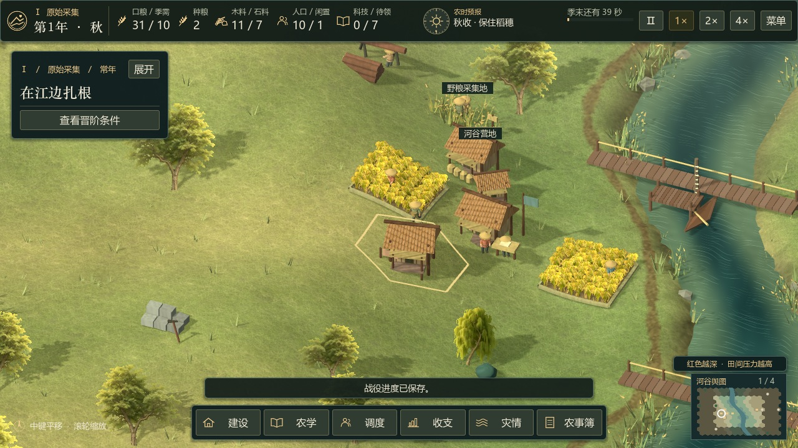
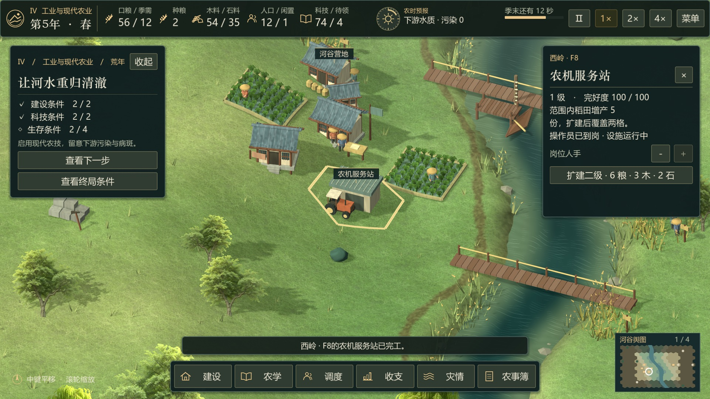

# 稻生江畔

一款可离线游玩的 Windows 2.5D 农业生存策略游戏。带十个人在长江河谷落脚，决定谁去采粮、谁留在农专、何时接纳新居民。可以把下一批口粮用来救汛、拓地或晋阶。每季四十秒，随时可暂停派工。

**[下载 Windows x64 试玩版 0.3.0](https://github.com/Imngenesis/TimeofAgriculture-AgricultureBall/raw/refs/heads/main/dist/RiceByTheRiver-Windows-x64.zip)**。完整解压，双击与资源包同目录的「稻生江畔.exe」。



## 第一年怎么玩

1. 给开局选中的野粮采集地派两人，再从「调度」给另一处采集地派人。每人每季要吃一份粮，冬天野粮更少。
2. 在「农学」选址建农专（3 粮、3 木、1 石，8 人秒）。农专到岗人员每合计工作 12 人秒编成 1 点科技。点农专领取，花 2 点研习「留种试种」。一项技术需 8 人秒，研习与编制点数共用人手。
3. 在「调度」封存种粮，每块田春夏播种用 2 份。点「建设」开田，留人照料。学「谷物晾晒」后建备荒粮仓。每块收获田优先保留至多 2 份种粮。
4. 营地的十张床开局已住满。想多派一个人，可建农舍（4 粮、4 木，每级添 4 床），在「调度」、营地或农舍点「招募 1 人」。每次花 **6 粮、2 木**，占一张空床，新居民立即可派，从当季起每季多吃一份口粮。

## 难度与收支

| 战役难度 | 开局口粮 / 木料 / 石料 | 秋收倍率 | 公共支出倍率 |
| --- | ---: | ---: | ---: |
| 丰年 | 42 / 22 / 12 | 115% | 75% |
| 常年 | 30 / 16 / 9 | 100% | 100% |
| 荒年 | 24 / 12 / 7 | 88% | 135% |

「收支」中的**本季预算**显示在田秋粮、居民口粮、公共开支、预计季末库存和溢仓。拨款可选节用、常规或充足，足额支付后，下季农务效率分别为 85%、100%、115%。季末先发居民口粮，再付预算。欠拨会拖累农务效率和组织度。营地口粮仓容为 48，粮仓每级再添 36。连续两季缺粮会减员，连续两季完全断粮会结束战役。

**料场与换货**定位竹木场与采石场。一般料场采 1 木需 10 人秒，采 1 石需 14 人秒。缺料时可在码头花 5 粮换 4 木或 3 石，卖出一批得 2 粮。**历季账簿**保留近八季的收支图和上季实际结算，包含工程、招募、换货、地租、救灾、晋阶与木石出入库。

服务拨款和地图维护费借鉴了《都市：天际线 II》的经济设计。在这里，决定是否开通一片土地时，玩家能同时看到它的农业优势和每季地租。[经济与生产开发日志](https://colossalorder.fi/news/development-diary-9-economy-production/) · [土地维护费说明](https://www.paradoxinteractive.com/games/cities-skylines-ii/news/tile-upkeep-explained)

## 河谷与人手

整张地图为 15 × 12，共 180 格。中央河谷开局可用，点击小地图可查看外围地块和开通条件。

| 地区 | 地区特点 | 开通价格 | 每季基础地租 |
| --- | --- | ---: | ---: |
| 中央河谷 | 72 格，营地与两种基础料场 | 已开放 | 0 |
| 上游竹埠 | 竹木场每 7 人秒产 1 木 | 8 粮、2 木 | 2 粮 |
| 两岸丘陵 | 采石场每 9 人秒产 1 石 | 6 粮、2 木 | 1 粮 |
| 下游沙洲 | 低田每块基础秋收加 5 份，临河选址要考虑夏汛 | 10 粮、2 木 | 2 粮 |

「调度」列出空闲、赴任、在岗人数和各岗位容量，可指名跨岗调人，也可以让系统就近调空闲人手，先抢险、再顾农时。缺工会在地块和侧栏出现提醒。灌渠、秧圃、农机站都要有人到岗才生效，一级覆盖一格，二级覆盖两格。工地可增派、撤工，按未完工比例退还实际投入的整份粮和材料。完好度低于 50 的设施须检修才能恢复服务。

## 四个时代

建设、核心科技和生存条件全部达成后，由玩家用可用口粮确认晋阶。确认前可查看提升的基础产量和下季预算。下表的时代事务按常年、常规拨款列出，设施运转和外圩地租另计。

| 当前时代 | 本时代每田基础增产 | 本时代每季事务费 | 晋阶条件与费用 |
| --- | ---: | ---: | --- |
| 原始采集 | +0 | 0 粮 | 建农专、稻田、粮仓，学留种与晾晒，完成首收并带种越冬。付 12 粮。 |
| 早期农耕 | +3 | 2 粮 | 经营两块田和农舍，有有效田堤或安全粮仓。学排水与巡查，过洪峰后复播，最近一季足额供粮。付 20 粮。 |
| 传统农耕 | +7 | 5 粮 | 建梯田或做轮作，有有效灌渠或二级粮仓。学筑田与轮作，经历梅雨后平均地力至少 54，连续两季足额供粮。付 32 粮。 |
| 工业与现代农业 | +12 | 8 粮 | 两块投产田、有效农机站或净水沟，学机械稻作与测土配肥，完成现代秋收。受病田恢复收获，下游污染最多 23，连续两季供足口粮并留齐种粮，手动确认通关。 |

夏汛和梅雨按农时到来。其余急报与技术的实际使用有关。晾晒入仓遇到成熟稻作会引来谷鸟，共渠灌到在田作物会引来草害，公共秧圃供秧会带来病情，启用化肥要应对尾水。也能靠扩仓、轮作和农机走通低投入路线。

## 画面、操作与存档

滚轮可从河谷总览拉近到稻株、农人的斗笠和农机车轮。农田、屋体、水车、农机和农人以三维几何绘制，树木和作物采用随风摆动的透明贴片。河水、地表、植被随农时、汛情和水质变化。[美术原图与生成提示](docs/art-assets.md)



空格暂停，数字 1、2、3 对应一倍、二倍、四倍速。用中键拖动或 WASD 平移，点击小地图定位，左键选址，右键取消，修堤时按 R 换边。每季、触发预警和晋阶时会自动存档。Esc 菜单可手动存读，失败后能从当前时代起点重试。0.1 和 0.2 的存档可直接继续，以常年难度进入新经济体系。

## 开发与验证

用 Godot 4.7.2 标准版打开[桌面工程](desktop/project.godot)，按 F5 运行。主要规则见[农业模拟](desktop/simulation.gd)、[预算与资源](desktop/economy.gd)、[人口与晋阶](desktop/settlement.gd)和[河谷地图](desktop/valley.gd)。

准备对应版本的 Windows x64 导出模板，在 PowerShell 运行构建脚本。可执行文件写入 `Windows/`，试玩包写入 `dist/`。

```powershell
.\build-windows.ps1 -Godot 'C:\Tools\Godot\Godot_v4.7.2-stable_win64_console.exe'
```

[原生交互回归](desktop/checks/playthrough.gd)通过鼠标和键盘事件操作同一套界面，从同一份洪水预警存档分别走通修堤、育秧、施肥和转运、扩仓、农机两条路线。难度参数 0、1、2 对应丰年、常年、荒年。截图、测试存档与结果写入单独的目录。

```powershell
$result = Join-Path $env:TEMP ("rice-valley-check-" + [guid]::NewGuid())
& '.\Windows\稻生江畔.exe' --resolution 1280x720 -- "--test-output=$result" --difficulty-test=1 | Out-Null
Get-Content -LiteralPath (Join-Path $result 'verification.txt')
```

[经营规则回归](desktop/checks/economy.gd)覆盖人口、缺工、木石、预算、地图、晋阶和田块产出。需要验证迁移时，可在命令末追加 `-- --legacy-file=<0.1或0.2存档副本的完整路径> --test-output=<临时目录>`。测试在临时目录保存升级后的副本。

```powershell
& 'C:\Tools\Godot\Godot_v4.7.2-stable_win64_console.exe' --headless --path desktop --script res://checks/economy.gd
```

根目录保留早期设计稿和网页版原型。桌面存档位于 `%APPDATA%\RiceByTheRiver`。引擎与第三方组件许可见 [licenses](licenses)。
