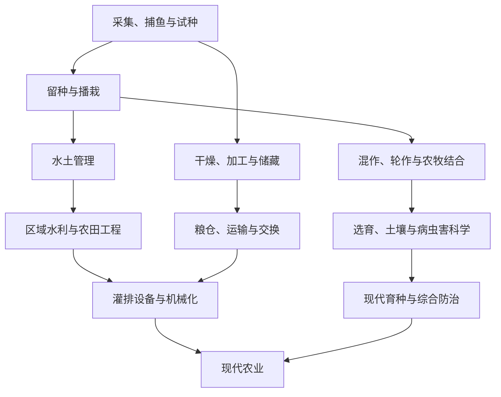
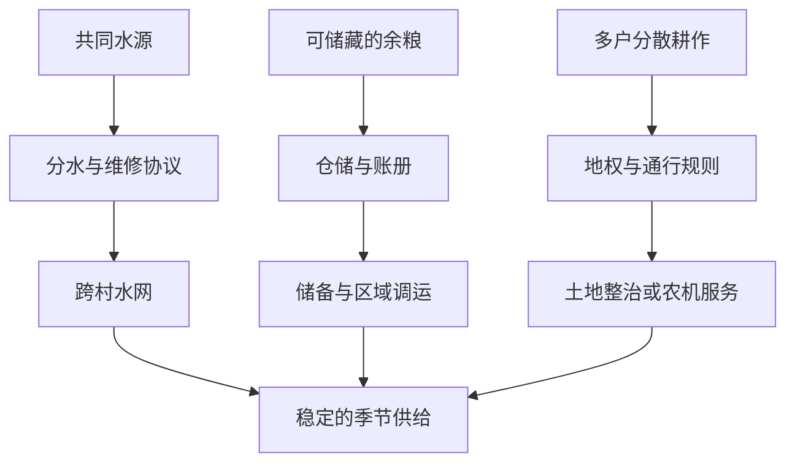

# 文明演进类小游戏：农业文明与科技树

## 1. 开局规则

玩家从一个依赖狩猎、采集和捕鱼的社区开始，在既有生计上试种当地植物。过了若干季，部分主食逐渐转向耕作。用“种植面积、留种比例、越冬存粮”表现这一过程。约旦河谷约 1.1 万年前已有驯化前粮仓，可把储藏设计为独立可研发的技术。[约旦河谷考古](https://doi.org/10.1073/pnas.0812764106)

开局界面可保留四个按钮：**稻、旱作杂粮、麦、根茎**。其中“旱作杂粮”按地图分出东亚粟黍、非洲珍珠粟与高粱、美洲玉米。若希望作物选项一眼可辨，可把玉米单列为第五个按钮。游戏分类里的“根茎”归并若干地下贮藏器官，方便选单：马铃薯是块茎，木薯是块根，芋是球茎；它们的气候、储藏和加工机制各有一套。非洲稻与亚洲稻为不同物种，可分别成为西非洪泛区和东亚湿地的初始选项。小麦、大麦在西亚驯化，传入欧洲和尼罗河流域后形成不同的地方农业体系。[全球农业起源综述](https://academic.oup.com/edited-volume/61750/chapter-abstract/545964162?login=false) · [西亚早期作物](https://doi.org/10.1086/658367) · [欧洲早期农民](https://pmc.ncbi.nlm.nih.gov/articles/PMC4922144/) · [非洲稻种群历史](https://pubmed.ncbi.nlm.nih.gov/29983312/)

以下年代是考古证据或实例的时间锚点，驯化、成为主粮和城市兴起通常相隔很久。箭头表示可采用的研发与演进顺序，年代按地图设置。

## 2. 代表性区域路线

| 代表地区与史实节点 | 自然地理 | 技术演进与玩法 |
|---|---|---|
| 西亚肥沃新月地带 → 两河流域。约 1.1 万至 1 万年前，小麦、大麦与豆类进入早期农业，逐步与绵羊、山羊饲养结合。 | 北部及山前雨养地与南部干旱冲积平原相连，水利需求不同。 | 麦豆雨养、留种和粮窖 → 农牧结合 → 南部引水渠、排水沟和粮仓 → 乌鲁克时期的城市供给与记账。引水和排水分别生效，配套可降低积水与盐分风险。 |
| 长江中下游：上山 → 河姆渡／田螺山稻作。上山距今约一万年前已有早期稻利用与管理证据，后来的遗址可见驯化性状逐步增加。 | 暖湿低地、季节涨水与可排水的浅湿地；山地地块受坡度限制。 | 稻的采收与留种 → 田埂、排灌 → 平原农田或山地梯田 → 依气候发展复种。田埂保水，排水设施减少涝损。云南哈尼梯田可用于后世山地地图。 |
| 华北黄河流域：早期粟黍农业 → 仰韶等定居农业 → 多作物旱作。 | 季节性降水，部分地区土壤易耕而坡耕地易侵蚀。 | 粟（谷子）、黍（糜子）→ 储粮、养猪 → 保墒与防蚀 → 在交换后引入麦类，部分地区形成跨季种植。短生育期品种可填补青黄不接。 |
| 南亚印度河：早期麦、粟类与豆类种植所在区域发展出哈拉帕城市网络，区域作物组合各异。 | 冬雨和夏季季风的影响有明显空间差异。 | 小麦、大麦等冬作 → 因地引入夏作小粒谷物、豆类或稻 → 分季播种、用水与交粮 → 城市供给。按地图水文配置两季风险。 |
| 欧洲：西亚农作经爱琴海进入欧洲，沿地中海及巴尔干—多瑙河等路线扩散。 | 地中海多为冬雨夏干；欧洲中北部部分地区土壤黏重、湿地多。 | 爱琴海／早期欧洲麦豆与家畜 → 南欧部分地区加上葡萄和橄榄，部分中北欧地区发展畜力重犁、排水与轮作 → 近代播种机、收割机及动力机械。重犁在黏重地块回报较高。 |
| 非洲尼罗河谷：早期埃及吸收西亚小麦、大麦、豆类和亚麻 → 王朝时期河谷农业。 | 狭窄冲积谷地、周期涨水、两侧干旱。 | 退水后播种 → 围堤和盆地用水 → 粮仓、运输与配给。可设计低水年与大水年两种风险。 |
| 非洲萨赫勒：马里一带公元前第三千纪已有驯化珍珠粟证据；东苏丹公元前第四千纪已有具部分驯化性状的高粱。 | 短雨季、降雨起始日期波动，干旱和牧草季节变化明显。 | 珍珠粟或高粱 → 雨养谷物与豆类组合、干粮储备 → 集雨、保墒、农牧协作。短季或耐旱作物稳定低雨年的产出。 |
| 西非洪泛地与森林边缘：西非独立驯化非洲稻与非洲白薯蓣，各适应不同环境。 | 尼日尔河洪泛湿地与几内亚湾森林—稀树草原过渡带提供不同生态位。 | 河谷：非洲稻 → 按涨退水择种、分区种植。森林边缘：薯蓣 → 起垄、搭架、留种薯与分期收获。后期可经大西洋交换引入美洲木薯。 |
| 中部美洲：墨西哥巴尔萨斯河谷约 8700 年前已有早期玉米证据，后来的玛雅、墨西加等发展出各自的农田系统。 | 季节性干旱林、高原及湖盆并存。 | 玉米 → 玉米、豆、南瓜组合（米尔帕，配置会变）→ 碱处理提高玉米营养可利用性 → 坡地梯田或墨西哥谷地湖区的奇南帕。奇南帕以固定高畦和水道为核心，可将挖渠、淤泥回田做成联动节点。 |
| 安第斯：马铃薯、藜麦等本地作物与驼科家畜形成高地农业，低一些的地带也可种引入的玉米。 | 海拔、坡度、昼夜温差和霜冻改变地块用途；谷地与高原生产互补。 | 分海拔耕牧 → 梯田、灌溉或高畦（因地解锁）→ 马铃薯冻干储藏和区域交换 → 后期扩展为印加等政体的储运体系。高原冷夜既能冻坏作物，也可为收获后的传统冻干提供条件。 |
| 亚马孙及邻近热带南美：玻利维亚莫霍斯平原约一万年前已有木薯利用或栽培证据，后来出现多样农业景观。 | 季节性淹水地、林缘与较高地块并存，不同流域的土壤与水文差异大。 | 木薯、南瓜等 → 扦插、错峰采收、加工和林园混作 → 某些地区发展人工林岛、高畦、沟渠或改良土壤。木薯可设为分批收获，鲜根采后需尽快加工。 |
| 北美东部林地：独立发展的本地种子作物体系，后来部分地区纳入从中部美洲传入的玉米。 | 河谷冲积地、林缘、不同成熟季节。 | 本地南瓜、向日葵、藜类等 → 多季采收与储藏 → 引入适应当地生长季的玉米。可与中部美洲玉米路线共享贸易节点。 |

**地区资料**

- 西亚： [早期作物](https://doi.org/10.1086/658367) · [南部两河流域古灌渠](https://www.cambridge.org/core/journals/antiquity/article/identifying-the-preserved-network-of-irrigation-canals-in-the-eridu-region-southern-mesopotamia/2B2BE82BACA8A2BEFCB4C43A140419C5) · [乌鲁克](https://www.metmuseum.org/de/essays/uruk-the-first-city)。
- 东亚与南亚： [长江稻作证据](https://pmc.ncbi.nlm.nih.gov/articles/PMC9728911/) · [田螺山驯化性状](https://pubmed.ncbi.nlm.nih.gov/19299619/) · [黄河流域早期小米](https://doi.org/10.15184/aqy.2024.190) · [稻粟麦的考古序列](https://pmc.ncbi.nlm.nih.gov/articles/PMC4604147/) · [哈尼梯田](https://whc.unesco.org/en/list/1111) · [印度河多作物研究](https://pmc.ncbi.nlm.nih.gov/articles/PMC6991972/)。
- 欧洲与非洲： [欧洲早期农民](https://pmc.ncbi.nlm.nih.gov/articles/PMC4922144/) · [中世纪欧洲重犁](https://www.sciencedirect.com/science/article/pii/S0304387815000978) · [埃及与努比亚早期农业](https://discovery.ucl.ac.uk/id/eprint/10119133/1/Nubia%20handbook%20final%20ms.pdf) · [马里珍珠粟](https://pmc.ncbi.nlm.nih.gov/articles/PMC8550313/) · [东苏丹高粱](https://discovery.ucl.ac.uk/id/eprint/1574602/7/Fuller_693898.pdf) · [非洲稻](https://pubmed.ncbi.nlm.nih.gov/29983312/) · [西非白薯蓣](https://pmc.ncbi.nlm.nih.gov/articles/PMC6527260/)。
- 美洲： [巴尔萨斯玉米](https://profiles.si.edu/display/sro_78031) · [墨西哥传统农食系统](https://www.fao.org/newsroom/story/traditional-agrifood-systems-conserve-biodiversity-and-support-nutrition-in-mexico/en) · [奇南帕](https://www.fao.org/giahs/giahs-around-the-world/mexico-chinampas-agricultural-system) · [安第斯农业](https://www.fao.org/giahs/around-the-world/detail/peru-agriculture/en) · [亚马孙早期栽培](https://pubmed.ncbi.nlm.nih.gov/32404996/) · [木薯起源与传播研究](https://doi.org/10.7183/1045-6635.22.4.452) · [北美东部农业体系](https://www.sciencedirect.com/science/article/pii/S0278416517301447)。
- 扩展地图：新几内亚高地库克遗址是独立农业发展的案例，约 7000–6400 年前有依赖芋、薯蓣与香蕉等无性繁殖作物的农业，由湿地边缘起垄逐步发展为挖沟排水。[联合国教科文组织](https://whc.unesco.org/en/list/887)

## 3. 通用科技树

以下连线用作游戏解锁示例，技术实际出现的时代因地区而异。水利与仓储建设可并行。机械化与育种也可以由不同地区先行。

| 技术簇 | 可做成的研发节点 | 触发条件与效果 |
|---|---|---|
| 生产与保全 | 石镰、掘土棒与锄、播栽、脱粒碾磨、干燥粮仓、根茎加工、选种、种苗留存 | 播种用种应在库存中单列。围护保护田块，密封隔潮可降低仓储损耗。粮仓也支持交换与灾后复种。 |
| 水土与肥力 | 田埂、排水沟、集雨、梯田、渠灌、覆盖、堆肥、粪肥、豆科轮作 | 地图按坡度、降雨、水源、排水性计算收益。旱区长年灌溉需管控排水与盐分；湿区新增灌溉的收益取决于季节。 |
| 劳动与动力 | 有役畜时可解锁畜力与犁，并可发展水力磨坊、机械播种和收割、拖拉机与联合收割机 | 大田连片、维修和能源供给决定大型机械的回报。陡坡与小地块可用轻型机械或发展分工与仓运。 |
| 科学与投入 | 田间对照试验、植物病理学、土壤检测、遗传学与系统育种、工业合成氨、化肥与植保 | 19 世纪的遗传学与农业化学打开现代技术分支。1913 年工业合成氨可以做事件节点；氮肥增加投入选择，也带来水质与供应依赖。 |
| 跨洋与区域传播 | 驿站和港口、引种试验、作物适应选育、健康种苗、植物检疫 | 1492 年后跨大西洋作物与家畜交换加速。玉米、马铃薯、木薯走向欧亚非，麦和部分家畜进入美洲。贸易提升作物与品种多样性，也会带来随种苗和运输传播的风险。 |
| 现代产量、韧性与效率 | 半矮秆品种、灌排与施肥配套、抗性育种、种质保存、综合病虫害管理、节水灌溉、遥感和精准作业 | 绿色革命以 1960 年代半矮秆麦和 1966 年推广的 IR8 稻作例子。允许玩家用增产、抗旱或控损技术的不同组合完成终局。 |

技术资料： [欧洲与全球农业史](https://academic.oup.com/edited-volume/56212/chapter/443858147) · [合成氨工业化](https://www.basf.com/global/en/who-we-are/history/Carl-Bosch) · [跨大西洋交换](https://openstax.org/books/us-history/pages/2-4-new-worlds-in-the-americas-labor-commerce-and-the-columbian-exchange) · [木薯加工与传播](https://www.fao.org/4/x5032e/x5032e01.htm) · [IR8](https://60.irri.org/) · [小麦育种](https://repository.cimmyt.org/bitstream/10883/864/1/26586.pdf) · [灌溉与盐分管理](https://www.fao.org/4/t0667e/t0667e0b.htm) · [IPM](https://www.fao.org/pest-and-pesticide-management/ipm/integrated-pest-management/en) · [植物检疫](https://www.ippc.int/en/about/secretariat/) · [农业自动化](https://www.fao.org/family-farming/detail/en/c/1613700/)。

## 4. 回合机制与首版范围

### 地块和灾害

每块地只需记 **热量与生长期、雨季／洪峰、水源、坡度、土壤与排水**。给每项技术一个建造条件和一个可观测效果。粮食结算可用“潜在收成 × 适地程度 × 田间存活比例”，再扣收获和储藏损耗，最后分配口粮、留种、交易与储备。政策或组织选项，例如共管水渠与社区互济，可以影响维护与共享能力。

| 威胁 | 触发条件 | 反制与代价 |
|---|---|---|
| 野生动物取食、仓鼠害 | 田块靠近栖息地，或储藏暴露 | 围护、看守、封闭仓储。消耗劳力或材料。 |
| 杂草、虫害与作物病害 | 依作物、天气、耕作和连续种植记录生成 | 除草、轮作、品种多样性、抗性育种、田间监测与综合治理。不同措施对应不同威胁。 |
| 外来物种或病虫随运输进入 | 贸易路线连通且存在适生环境 | 健康种苗、入境检疫、监测与早期处置。检查占用运输能力，并降低传播概率。 |
| 饥荒 | 减产、储藏损失、运输中断与分配受阻叠加 | 跨季储备、多作物错峰、跨区交换、预警和应急配给。把人均可获得的口粮纳入结算。 |

可用多代留种表现作物性状变化，用连续种植、天气与反复施加同一防治措施下的选择压力表现病虫害风险演变。杂草、病害、野生动物和外来入侵各自有来源，能让玩家通过田间信息选择反制。终局可以设为“跨多个季节满足口粮与留种，经历一次严重灾年仍可恢复，同时把水耗和土壤退化控制在预算内”。

### 首版地图

- **长江湿地**：亚洲稻。主决策是田埂保水与排涝的平衡。
- **萨赫勒雨养地**：珍珠粟或高粱。主决策是何时播种、是否分批下种，以及如何熬过歉收。
- **多瑙河流域**：传入的麦豆与畜力。主决策是轻重土壤上的耕作投入与储备。
- **墨西哥季节性干旱区**：玉米、豆和南瓜。主决策是多作物搭配与季节分工。
- **安第斯高地**：马铃薯与藜麦。主决策是海拔分带、霜冻风险与收获后储藏。

五张地图可共用回合结算、人口和库存规则。湿地稻作的“先排后蓄”、萨赫勒的“雨季一到就播”和安第斯的“借冷储粮”分别由同一套地块属性产生。

## 5. 主粮怎样改变生产方式与文明组织

作物影响的是可行的生产和组织方式。可以沿四条机制推演：**水和劳力要不要同步、收成能否计量和搬运、加工要离田多近、耕作与交换要覆盖多大范围**。人口、道路、市场、原有土地权利、公共工程和政治压力会反过来影响选种和种植规模。Boserup 将人口压力视为促使人们缩短休耕、增加劳动投入的力量之一。游戏可用人口增长、可用土地和市场需求触发集约化，同时记录每亩产出与每人日净产出。[Boserup，农业增长条件](https://www.routledge.com/link/link/p/book/9781138878600)

| 主粮与场景 | 作物特征与生产技术 | 制度与聚落的演进选项 |
|---|---|---|
| 灌溉稻：巴厘岛苏巴克、东亚稻区 | 同一渠系的上、下游用水相互影响。部分稻作有集中农忙，邻近田块的种植与休耕时序也可能影响虫害。在巴厘岛，有研究结合田块分布与模型讨论分水和病虫害如何促成跨田块协作。 | 互助换工 → 用水户协会 → 跨村协调。设定轮灌、维修工日、分水监督与争端仲裁。协会可以服务多个村落。另可选择行政调水，按水网而非人口密度估算调度效果。[巴厘岛苏巴克](https://whc.unesco.org/en/list/1194) · [Lansing 等，2017](https://pubmed.ncbi.nlm.nih.gov/28584107/) · [Ostrom 与 Gardner，1993](https://ideas.repec.org/a/aea/jecper/v7y1993i4p93-112.html) |
| 小麦与大麦：两河流域、英格兰中部 | 干粮便于计量、储藏和运输。两河流域的早期文字与行政记录有关，可做粮仓、度量衡和配给链。英格兰的季节性播种、轮作和共享牧地则提供另一条组织路线。 | 两河：户仓 → 公仓或机构仓 → 度量衡、登记和供给中心。英格兰部分地区：家庭经营散布的条田 → 村社协调轮作、放牧权和农时 → 保留开放田制，或通过整地、租佃、圈地等方式改变经营规模。Allen 对英格兰中南部的研究发现，开放田制下的小规模农户已实现相当一部分生产率增长。[早期文字与行政](https://www.metmuseum.org/de/essays/the-origins-of-writing) · [英格兰轮作](https://doi.org/10.1093/9780191988905.003.0004) · [Allen，1992](https://academic.oup.com/book/34575) |
| 珍珠粟与高粱：萨赫勒雨养地 | 地方品种开花期、生长期与雨季适配程度不同。可安排分期播种、储备不同熟期的种粮，以及轮作、农牧互补。 | 家庭储粮 → 村际种子交换与应急储备 → 设立定期集市、商路与牧道通行协议。洪泛地邻区可接入稻作、渔业和交换节点。尼日尔内三角洲的杰内-杰诺及周边遗址可作为多聚落网络的参考，与雨养粟作区分开建图。[萨赫勒耐候育种](https://onlinelibrary.wiley.com/doi/10.1111/j.1439-037X.2012.00526.x) · [杰内-杰诺考古](https://www.cambridge.org/core/journals/journal-of-african-history/article/abs/inland-niger-delta-before-the-empire-of-mali-evidence-from-jennejeno/111CBA0644CA0D9EE7B3210C7A8F50F6) |
| 玉米：中部美洲、亚马孙西南部 | 可干藏的籽粒连接农户、加工与交换。墨西哥可走玉米、豆与南瓜的多作物组合，也可在湖区经营水道和高畦。莫霍斯平原部分卡萨拉韦遗址的研究发现玉米主导的栽培与排水田。 | 玛雅低地可做居住点与耕地交织、由道路连接多个中心的地图。墨西哥湖区可走家庭耕作、公共水道维护和集市供给。卡萨拉韦可做低密度城市网络。相似主粮可支撑不同的土地利用与聚落密度。[墨西哥农食系统](https://www.fao.org/newsroom/story/traditional-agrifood-systems-conserve-biodiversity-and-support-nutrition-in-mexico/en) · [索尔托坎高畦](https://www.cambridge.org/core/journals/ancient-mesoamerica/article/abs/chinampa-agriculture-surplus-production-and-political-change-at-xaltocan-mexico/F12AD6C61249DB4C428DF2B030CD3EE8) · [玛雅低地激光雷达](https://pubmed.ncbi.nlm.nih.gov/30262469/) · [卡萨拉韦城市网络](https://doi.org/10.1038/s41586-022-04780-4) · [卡萨拉韦玉米研究，2025](https://www.nature.com/articles/s41586-024-08473-y) |
| 马铃薯：安第斯不同海拔带 | 块茎繁殖需要保存健康种薯，鲜薯和冻干产品可分别计入库存。海拔、夜间低温与交通改变种植和储藏的成本。 | 家庭分海拔耕作 → 村际调运与储备 → 沿道路设多个地方仓，以统一规则调拨。印加时期绍沙地区的考古发现显示，52 处仓储建筑群分布有逾 2,000 座库房，出土包括马铃薯、藜麦和玉米，本地居民参与生产与管理。可由这个案例设计“统一调度、多点存放”。[安第斯农业](https://www.fao.org/giahs/around-the-world/detail/peru-agriculture/en) · [安第斯传统加工](https://www.fao.org/4/i1466e/i1466e.pdf) · [印加绍沙仓储](https://www.cambridge.org/core/journals/american-antiquity/article/abs/distribution-and-contents-of-inca-state-storehouses-in-the-xauxa-region-of-peru/44F144741EF4B0D4B4C8451015173A75) |
| 木薯：热带南美上欣古河流域 | 可分批从地里收取，鲜根采后易劣变。加工能力与运输时间决定可交付量，可把鲜根和加工品设成库存寿命不同的资源。 | 家庭田园 → 近田加工点 → 稳定村落、道路联络与区域交换。上欣古河的研究将木薯栽培与定居放在同一区域考察，聚落研究则记录了道路连接的多中心景观。西南亚马孙另有玉米主导的案例，区域作物谱可随地图设置。[木薯采后储藏](https://www.fao.org/4/x5415e/x5415e04.htm) · [上欣古河木薯与定居](https://www.cambridge.org/core/journals/antiquity/article/abs/manioc-agriculture-and-sedentism-in-amazonia-the-upper-xingu-example/39CA7051992BFABF4FD4DD4193BC58BA) · [上欣古河聚落](https://pubmed.ncbi.nlm.nih.gov/18755979/) |

### 研究结论在游戏里的用法

- **谷物与征收。** Mayshar、Moav 与 Pascali（2022）提出，谷物较容易观察、计量、运输和储藏，可能降低征收成本，并在比较数据中报告了谷物适宜性与政治层级之间的因果证据。Cook 等（2026）的复核发现，结果主要出现在由部落或酋邦迈向国家的比较中，且对少量极端样本敏感。适合把“收成能否被记录并征收”设成可随加工、交通和治理改变的成本。印加案例显示，多种作物和地方仓也能纳入统一调度。[原研究](https://doi.org/10.1086/718372) · [复核](https://doi.org/10.1086/740225) · [绍沙仓储](https://www.cambridge.org/core/journals/american-antiquity/article/abs/distribution-and-contents-of-inca-state-storehouses-in-the-xauxa-region-of-peru/44F144741EF4B0D4B4C8451015173A75)
- **稻作与协作。** Talhelm 等（2014）比较了中国不同地区受试者的心理测量，2024 年后续研究利用两个国营农场中近似随机的稻麦分配比较农户。其结果为特定环境下作业相互依赖与社会行为的关系提供了证据。游戏里可把它实现为可观察的用水冲突、共修工期和换工需求。雨养、直播、独立水源和机械服务会改变这些依赖关系。[2014 年研究](https://pubmed.ncbi.nlm.nih.gov/24812395/) · [2024 年研究](https://pubmed.ncbi.nlm.nih.gov/38413584/) · [巴厘岛水利协作](https://pubmed.ncbi.nlm.nih.gov/28584107/)
- **主粮与人口、城镇。** Nunn 与 Qian（2011）利用旧大陆各地种植马铃薯的适宜性差异及传入时间，估计马铃薯推广推动了人口和城镇化增长。可将引种的结果写为“改变安全口粮上限”；城镇是否增长，仍取决于运输、加工、交易及城镇工作机会。[论文](https://doi.org/10.1093/qje/qjr009)

## 6. 可研发的社会制度

制度节点用工日、信用、议事成本和审批权体现。每项可以单独采用或组合。租佃和公有安排可改变土地经营权，水权和仓储规则可单独设定。同一村的居民可能分别是承租者、公共草地使用者和水渠协会成员。

| 制度节点 | 解锁前提 | 玩家决定与代价 |
|---|---|---|
| 家庭耕作与种粮权 | 定居播栽、可跨季界定地块 | 设定家庭自用、留种和继承规则。稳定使用权提高长期整地意愿。继承分割会增加跨地块协调与机械作业成本。 |
| 公地与村社议事 | 多户共同使用牧场、田道或水源 | 制定谁可使用、何时开放、如何维护和处理争端。规则清晰可降低拥挤和冲突。协商与监督需要人力。 |
| 轮灌与跨村用水协议 | 共用渠道、辨识上下游受益者 | 设分水次序、枯水年配额、维护工日、申诉渠道。上游水量优势、下游减产风险与违规处理分开算。 |
| 粮权与储备治理 | 能计量或加工、具储藏地点与保管人 | 选择户仓、村社互助粮仓、集中仓或分布式仓网。设置征购、税粮、借粮与灾年放粮条件。记录库存是否可达与谁有调用权。 |
| 地权登记、租佃、整地 | 地界与度量、裁决渠道 | 可整理连片经营，也可维持多户地权并共用田道。将土地所有权和经营权分开。追踪地租、进入门槛、迁出和公共用地变化。 |
| 合作社与农机／加工外包 | 可交易、跨户排程和合同记录 | 分散农户可以共购设备、外包收割或共用加工点。规模收益体现在服务环节，农忙档期冲突和服务中断成为代价。 |
| 区域市场与灾年配给 | 运输、库存账册、跨聚落协议 | 可设市场集散、粮食转运与应急储备。市场提高调货范围；钱不够、路不通或放粮条件未触发时，仍会发生饥饿。 |

制度参考：[尼泊尔灌溉规则与绩效](https://www.cambridge.org/core/journals/journal-of-institutional-economics/article/abs/rules-and-collective-action-an-institutional-analysis-of-the-performance-of-irrigation-systems-in-nepal/16500439FDC02AB318ED1891BE4ED2B9) · [农业土地关系](https://www.sciencedirect.com/science/article/pii/S1573447195300198) · [FAO 农业合作与价值链](https://www.fao.org/agriculture/crops/thematic-sitemap/theme/spi/scpi-home/framework/policies-for-scpi/agricultural-marketing-institutions-and-value-chains/en/)。

### 土地、经营、仓储、聚落与权力各有一套状态

- **土地所有权**记录持有人。**经营规模**记录一个经营者实际耕作的面积与连片度。大型家庭经营、公司经营和小农户跨村外包都能使用机械。USDA 记录了美国作物耕地向较大经营单位集中且家庭农场持续占主导的现象。中国农机研究则记录了专业服务商跨区为分散农户作业的模式。[USDA 作物农场规模](https://ers.usda.gov/publications/45110) · [中国农机外包，2017](https://www.fao.org/family-farming/detail/en/c/411329/)
- **仓储集中度**记录库存分布及每处可辐射的范围。**权力集中度**记录决定征收、用水和调拨的主体。可以统一调度多个仓，也可以由各村共用一处大型加工点。[印加绍沙仓储](https://www.cambridge.org/core/journals/american-antiquity/article/abs/distribution-and-contents-of-inca-state-storehouses-in-the-xauxa-region-of-peru/44F144741EF4B0D4B4C8451015173A75)
- **聚落形态**由住处、耕地、加工点和市场之间的距离生成。可设分散农庄、集中村、多中心低密度城镇、人口密集的市场城。若平均耕作往返时间过长，可新建居住点；若粮运、公共服务和市场收益较大，则可扩充枢纽。用路网上的出行时间衡量聚落效果。[玛雅低地聚落](https://pubmed.ncbi.nlm.nih.gov/30262469/) · [莫霍斯低密度城市](https://doi.org/10.1038/s41586-022-04780-4)

## 7. 将制度分支接入原科技树

每回合可增加三项与技术线共用的结算。**用水**按渠段计算谁先用、谁分担维护；**交粮**按加工时间、剩余保质期与通行时间结算；**通勤与运输**按各类型聚落和田仓距离消耗工日。歉年或运输中断时，报告“有多少粮、多少能运到、多少家庭领得到”。这三项可以让同一科技在不同制度下产生不同效果。

首版可用三组同图对照检验制度是否有实际作用：

- **长江湿地**：同样的渠系，一局由各村订轮灌协议，一局由区域机构统一配水。连续旱季后比较下游缺水、维修进度和调度工日。
- **多瑙河及中欧麦作地图**：同样的小麦过渡到机械化，一局整合田块，一局保留小农经营并使用共享农机。比较收割窗口利用率、地租和低收入农户的口粮。
- **安第斯高地**：同样的马铃薯与藜麦，一局建单一中心大仓，一局按道路布设地方仓并统一登记。暴雨中断一段道路后，比较粮食可达率和恢复速度。

## 8. 从田间管理到实际产量

设计一项农业技术时，先标出它改变哪个量：可种面积、每年可收的茬数、每茬实收、灾年损失、种用消耗，或入仓后损耗。下表中的数值来自当代研究，适合校准地理条件、收益方向和效果量级。古代关卡的基础单产需要独立设定。

| 作物与管理决策 | 实测效果及比较基准 | 对技术与组织的启示 |
|---|---|---|
| **水稻：灌多少水** | 56 项研究、528 组田间比较。相对持续淹水，温和干湿交替平均节水 23.4%，多数条件下产量差异未达显著；过度干燥平均减产 22.6%。[Carrijo 等，2017](https://doi.org/10.1016/j.fcr.2016.12.002) | 农户要能观察田间水位，并在需要时重新引水。维护支渠、轮灌排程和上下游水权决定能否执行这项技术。把田间节水计入可分配的灌溉预算；流域还要另算回流水。 |
| **粟：在同一场雨里留住更多水** | 中国黄土高原用同一谷子品种、在相同施氮水平下比较垄沟集雨与平作。2022 年各处理增产 3.7%–14.3%，少雨的 2023 年为 2.8%–27.6%。过了当地肥力响应区间，增加施氮的附加收益很小。[《中国农业科学》，2024](https://www.chinaagrisci.com/EN/10.3864/j.issn.0578-1752.2024.05.005) | 家庭可先整治小块坡地，有劳力和共用田道后才扩大。把修垄算入播前工日，按年份和水肥条件计算收益。此次试验作物为粟（谷子），黍需另校准。 |
| **珍珠粟与高粱：把失去生产力的地块恢复为耕地** | 布基纳法索案例记录，在原先几乎无收成的严重退化地，采用带有机质的 zaï 集雨种植坑后，高粱少雨年约收 0.3–0.4 吨/公顷，好雨年可达约 1.5 吨/公顷。该比较同时包含水土修复与养分投入。[Kaboré 与 Reij](https://ageconsearch.umn.edu/record/16087/files/ep040114.pdf) · [土壤恢复田间研究](https://doi.org/10.1080/089030699263230) | 玩法应同时解锁可用地和单位面积收成。挖坑、运有机质都占用工日，与农牧交换、换工队和运输距离相连。不能把退化地恢复的增幅套到现有良田。 |
| **小麦：连续种麦还是轮作** | 英国 Broadbalk 试验 1986–2017 年资料显示，轮作后的第一茬冬小麦平均产量更高，在研究比较的施肥处理中跌破产量门槛的风险也更低。各处理组合的平均产量约 4.7–9.6 吨/公顷，跨度同时包括轮作与施肥差异。[Macholdt 等，长期试验](https://doi.org/10.1017/S0021859620000301) | 单户可安排轮作，共用开放田、畜群和农机时则需要协调季节。核算多年粮食、豆类或饲料总产，同时扣除轮作中没有种麦的年份。 |
| **玉米：单作还是搭配豆科等作物** | 一项非洲玉米间作荟萃分析报告平均土地当量比约 1.45。其含义是，单作分别生产与 1 公顷间作相同数量的两种作物，估计合计需约 1.45 公顷。中国与非洲的另一项玉米—食用豆类分析也发现两地土地当量比均高于 1。[Bott 等，2026](https://doi.org/10.1016/j.eja.2026.128143) · [玉米与豆类的 73 篇研究汇总](https://agris.fao.org/search/en/providers/122535/records/65df406b4c5aef494fe141c4) | 玉米和豆子分别计产、计热量和蛋白质。家庭混作、分行种植与机械收获各有劳力要求。土地当量比不能作玉米单产或人口的乘数。 |
| **马铃薯：从哪一批植株留种薯** | 肯尼亚农户管理的试验中，从田间健康植株选留种薯，相比原有选种方式，下季块茎平均增产 34%。研究者记录了额外标记与选收工时。这里计量的是鲜薯重量。[Gildemacher 等，2011](https://doi.org/10.1007/s11540-011-9190-5) | 家庭选种、村级种薯供应和现代健康种薯服务可逐级建立。留给下一季的种薯会减少本季可食库存。 |
| **木薯：何时挖、在哪里加工** | 成熟木薯可在适当条件下分批采收，鲜根采后迅速劣变。相同的田间鲜重，在集中采收、加工能力不足时，到户可食产量会更低。[FAO 木薯生产指南](https://www.fao.org/4/i3278e/i3278e00.htm) · [根茎作物采后处理](https://www.fao.org/4/x5415e/x5415e04.htm) | 分批起收、近田加工和共享加工设施形成一组连续选择。上调加工能力会缓解收获高峰的排队损失；留在地里的木薯继续占用土地。 |

**从人口史校验方向。** Nunn 与 Qian 将马铃薯传入旧大陆的时间与各地种植适宜性相结合，发现适宜地区随后有更大的人口与城镇化增长。这类历史估计描述长期人口变化。下节的口粮计算回答较窄的问题，即在给定投入、收成和分配条件下，可以供给多少人的食物能量。[Nunn 与 Qian，2011](https://doi.org/10.1093/qje/qjr009)

## 9. 把单产换算成可持续供粮人数

在同一块田上，先按季登记收获，再将复种、间作与休耕合并到同一公顷、同一整年。间作田的各作物单产以间作田总面积为分母；跨年轮作使用完整轮作周期的年均数。农忙时劳力不足或种苗短缺，会减少实际播种、及时收获的面积。[FAO 食物平衡表方法](https://www.fao.org/4/x9892e/X9892e01.htm)

1. **到户热量**。先在原粮或鲜根口径扣除留种、饲用与田后损失，按各自的加工出品率换算为可食重量，再乘该种成品每千克的热量。上季库存、调入、调出和期末保留量，都在统一口径下单独记账。木薯和马铃薯的鲜重含大量水，稻谷含稻壳，三者直接按吨排名会失真。
2. **可供养人数**。年度到户总热量除以人均日能量预算与 365 的乘积，得到“口粮热量当量人数”。若该批粮只承担膳食的一部分，应另列其余食物来源，并核对蛋白质等约束。它是给定土地与投入下的供给指标。实际人口还受饮水、疾病、迁移、劳动和家庭取得食物的能力影响。
3. **灾年与长期承载力**。分别显示平年、指定灾年和连续两年歉收后的可供人数。模拟长期稳定人口时，逐月检查能否度过青黄不接、是否留下种粮、年末储备是否达标；还要让肥力、水源和劳力跨年结转。汇总多地时，同一次气候事件可能打击邻近村庄。贸易与储备的保障能力取决于交通和受灾范围。

### 一个可以复算的洪水关卡

设有 100 公顷稻田，平年收稻谷 2.5 吨/公顷。洪水淹没其中 40 公顷约 10 天，假设普通稻在受淹田只收 1.0 吨/公顷。印度奥迪沙邦 128 村随机田间试验估计，遇到约 10 天淹水，耐淹稻 Swarna-Sub1 比当地对照品种高产约 45%，无洪水时未观察到产量惩罚。因此在这个关卡里受淹田取 1.45 吨/公顷。只把这一相对效果借自试验。[Dar 等，2013](https://pubmed.ncbi.nlm.nih.gov/24263095/)

其余均为示例参数。假定 90% 稻谷在扣除留种及损耗后可供碾米，出米率 65%，每千克成品米按 3,600 千卡计算。每人全年统一按 2,300 × 365 千卡记账，示例不含其他食物、贸易和跨年库存。每吨稻谷因此约合 2.51 人年的口粮热量。

| 场景 | 村落稻谷实收 | 稻米可提供的年度热量，折合约多少人 |
|---|---:|---:|
| 平年 | 100 × 2.5 = 250 吨 | 627 人 |
| 洪水，普通稻 | 60 × 2.5 + 40 × 1.0 = 190 吨 | 477 人 |
| 同一洪水，受淹田采用耐淹稻 | 60 × 2.5 + 40 × 1.45 = 208 吨 | 522 人 |

**耐淹性保住了约 45 人一年的热量。** 受淹田增产约 45%，全村洪水年增幅是 18 ÷ 190 ≈ 9.5%。若只把种子配送到一半受淹田，新增热量也约减半。若道路被淹，库存和到户量还会出现差距。这样可以比较排水工程、耐淹种子配送、村仓和道路修复，找出同一笔工日或经费能保住多少实际口粮。

## 10. 自然灾害与病虫害的应对

同一技术作用于不同环节时需要不同的结算。田间防灾记录收回多少鲜薯或籽粒；仓储防虫记录保住多少重量；跨村救济记录灾民实际拿到多少食物。下表给出可选措施与各自的适用范围。

| 农业系统 | 气象与地形风险 | 田间病虫害与采后风险 | 协作与代价 |
|---|---|---|---|
| **河谷稻作** | 短时淹水可用耐淹品种、排沟和分地块播种。季节性缺水可用轮灌、田埂与温和干湿交替，须保有及时复灌的能力。 | 稻瘟病可用品种多样性降低风险。云南特定组合中，感病品种与抗病品种混栽后，感病组分的病害严重度比单栽低 94%，该组分的产量高 89%。对稻飞虱可用田间监测、保护天敌与综合防治。 | 村际协调供水、共用虫情信息和种子供应。田间试验的组分增幅只作用于相应组分。[云南混栽试验](https://pubmed.ncbi.nlm.nih.gov/10963595/) · [水稻病虫综合防治](https://www.moa.gov.cn/ztzl/2023cg/jszd_29356/202302/P020230228396277439641.pdf) |
| **温带麦作与灌溉麦田** | 旱地调播期、轮作、保墒；潮湿地块维护排水。盐渍化关卡中同时管理灌排与作物耐盐性，大麦可作为较耐盐的谷物选择。 | 锈病宜通过抗性品种组合和区域预警管理。蚜虫按田间调查、作物生育期和天敌情况决定是否干预。 | 家庭管理田块，村社管理田道和排水，跨区植保网络负责预警。换茬收益按整轮作周期计算。[长期麦作试验](https://doi.org/10.1017/S0021859620000301) · [FAO 耐盐资料](https://www.fao.org/4/Y4263E/y4263e0e.htm) · [小麦锈病协作](https://www.fao.org/in-action/fao-turkey-partnership/projects/project-detail/en/c/1363050/) · [麦蚜监测](https://extension.sdstate.edu/aphid-populations-detected-wheat) |
| **半干旱粟黍、珍珠粟与高粱** | 华北粟作可用垄沟集雨。萨赫勒依靠集雨坑、等高石埂、不同熟期品种和补播种粮；若整个雨季失败，田间措施仍需外围粮源支持。 | 珍珠粟霜霉病可用适地抗性品种和健康种子管理。寄生杂草独脚金会危害部分非洲谷物，宜配合轮作、土壤肥力与综合治理。 | 建设工程占用旱季工日，种子互济占用可食库存。各地区的作物与病虫名单分别配置。[萨赫勒集雨坑](https://doi.org/10.1080/089030699263230) · [珍珠粟综合植保](https://niphm.gov.in/IPMPackages/Pearlmillet.pdf) · [ICRISAT 独脚金管理](https://oar.icrisat.org/1004/1/RA_00239.pdf) |
| **玉米与玉米—豆类系统** | 开花期水分亏缺影响结实，可调整播期、在关键生育期补水，或用多作物分摊风险。 | 东非农户研究中，适应当地条件的伴生植物“推拉”系统减少了草地贪夜蛾危害。入仓后另管仓虫。肯尼亚随机试验中，密封袋将虫害失重从 1.7% 降至 0.4%，受损籽粒比例则从 14% 降至 4%。 | 伴生植物需要种苗、面积和管理。粮仓需要干燥合格的籽粒和储藏材料。每 100 吨同条件入仓粮对应保住约 1.3 吨重量。[水分与玉米结实](https://agris.fao.org/search/en/providers/122436/records/675ac8270ce2cede71d16518) · [东非推拉试验](https://www.sciencedirect.com/science/article/pii/S0261219417303216) · [肯尼亚储粮试验](https://www.sciencedirect.com/science/article/pii/S0261219416302071) |
| **高地马铃薯** | 霜冻可用耐霜品种、海拔分带与分散地块分摊风险。冻干加工利用的是收获后的低温，田间冻伤单独记损。 | 晚疫病可用抗性品种、田间监测及因地制宜的综合防治；种薯质量另通过家庭选留与健康种薯供应维护。 | 维持多品种和种薯储备占用仓容。道路与地方仓决定偏远地块的收成能否调到缺粮村。[安第斯耐霜马铃薯](https://pmc.ncbi.nlm.nih.gov/articles/PMC10948431/) · [晚疫病抗性品种](https://link.springer.com/article/10.1007/s12230-023-09917-3) · [肯尼亚种薯研究](https://doi.org/10.1007/s11540-011-9190-5) |
| **热带木薯** | 成株较能忍受间歇干旱，建植期仍受缺水影响。积水地块设排水或高垄，延迟采收要承担占地和田间损耗。 | 用健康种茎、适地抗性品种与监测管理木薯花叶病。采后通过匹配日采收量与加工能力减少劣变。 | 种茎互助、加工合作社和近田道路作用于不同环节。修路后还要检查加工点是否拥堵。[FAO 木薯生产与植保](https://www.fao.org/4/i3278e/i3278e00.htm) · [采后储藏](https://www.fao.org/4/x5415e/x5415e04.htm) |

原型可对同一地图固定天气和虫情，轮流开放不同措施。每局记录四个结果：**公顷年均可食热量、每工日到户热量、灾年最低月口粮、灾后次季可复种面积**。如果节水降低了每吨粮的耗水却没有增加人口，或密封仓在没有增产时让村落渡过荒季，这些都能由结算账解释。
