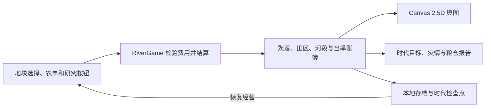

# 稻生江畔 · 四时代试玩版设计与实现

试玩入口是同目录的单文件 HTML。每回合操作一个有代表性的农季，聚落跨时代继承粮仓、农田、建筑和技术。当前地图由 9 列、8 行六角格构成，四块具名田区供玩家经营。游戏里的粮食以「份」计，每人每季需要一份口粮。 [打开试玩版](<稻生江畔-四时代.html>)

## 玩家在地图上做什么

玩家从十人、三十份粮和一个江畔营地开始。每季先看缺粮或灾情预报，再决定把工日用在采集、开田、研究还是公共工程上。点击结算后，春播、秋收、口粮和河道污染按同一顺序更新。受灾地块的上茬实收、下游污染和粮仓账簿可以回看。

六角地形和科技前置借鉴《文明 VI》的空间经营与研究玩法。灾前调度、粮种分配和组织度借鉴《冰汽时代》的生存抉择。河岸平田产量较好，也容易被淹。高地粮仓能保种，建在低地的仓需要田堤保护。地图选址因此会改变同一场洪水的后果。 [《文明 VI》发行方介绍](https://store.steampowered.com/app/289070/Sid_Meiers_Civilization_VI/) · [《冰汽时代》开发方介绍](https://store.steampowered.com/app/323190/Frostpunk/)

| 时代 | 两项农业科技 | 可执行的农事与建设 | 过关检验 |
|---|---|---|---|
| Ⅰ 原始采集 | 留种试种、谷物晾晒 | 采集野粮、封存种粮、建试种圃或备荒粮仓 | 有实际收成，渡过冬季，保有两份种粮 |
| Ⅱ 早期农耕 | 圩堤排水、田间巡查 | 修堤、巡田，在洪峰前决定抢护田埂或转运粮种 | 经历洪峰，随后重新播种并足额供粮 |
| Ⅲ 传统农耕 | 等高筑田、稻豆轮作 | 修梯田、实施轮作、施用堆肥，承受一次梅雨冲刷 | 有效护土，耕地平均地力达到 54，连续两季足额供粮 |
| Ⅳ 工业与现代农业 | 机械稻作、测土配肥 | 建农机服务站、精准施肥、修净水沟，决定怎样拦蓄尾水和应对疫病 | 现代农技已投入使用，疫病冲击当季或之后有收成，下游污染至多 23，连续两季足额供粮且留足下次播种所需 |

「留种」把两份现粮划为种粮。春播每田从已封存的种粮中扣两份，秋收后每块收成田自动留两份。粮仓账簿允许把种粮重新划作口粮。连续两季实际发粮为零、人口归零或组织度耗尽，都会触发失败。

## 单文件架构

| HTML 中的位置 | 实现职责 |
|---|---|
| `script#simulation` | 定义时代、科技、地块与危机。玩家操作从 `act`、`research`、`advance` 和 `respond` 进入。费用校验通过才会改变状态。每季账簿能从期初库存复算至期末库存。 |
| `script#atlas` | 用固定斜视角绘制六角格顶面、侧壁、林地、水面、稻田和设施。点选使用同一套投影。洪水覆盖低田，地力过低留下冲刷纹路，河水颜色随所在河段的污染变化。 |
| `script#interface` | 显示可执行操作及禁用原因，处理危机弹窗、回合报告和存档。重大决策先保存，选定措施后结算一次。进入新时代会建立重试点。 |

原试玩包的统一粮仓、留种、地块差异、共用工日和逐季收成构成规则基础。新版增加无耕地开局、独立的地力指标和上中下游三个污染数值。污染根据上一季各河段数值向下游转移，本地农田的投入与净水沟改变本季负荷。运行只需浏览器。浏览器限制本地文件存储时，界面会提示本次打开期间可保留进度。 [原离线试玩包](<稻生江畔-离线试玩包 (1).zip>) · [MDN 本地文件存储说明](https://developer.mozilla.org/en-US/docs/Web/API/Window/localStorage)

## 试玩验收

- **开局到终局**。从同一起点分别走「田堤、梯田、精准水肥」和「湿地开田、轮作、机械稻作」两条路线。检查四个时代按顺序推进、污染沿河转移、最后一季的种粮够播现有田块。
- **失败与续玩**。在洪峰弹窗刷新，确认回来后仍需作同一次选择。分别检查结算前后支出、连续断粮结局和从当前时代重试的库存。
- **离线操作**。断网后双击 HTML，测试田面选地、地图缩放、研究和建设。手机窄屏可用田区下拉菜单选择同一块地。
