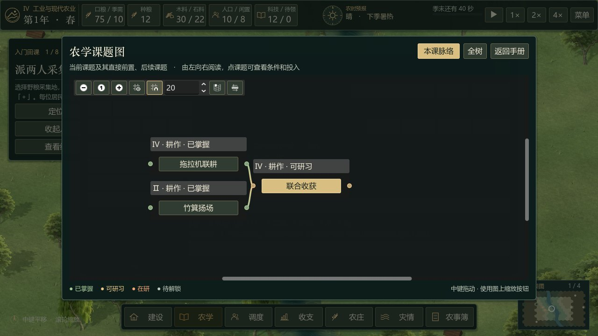

# 百谷长青 V1.15 正式版 · 农学手册

按 **T** 打开手册。先点本地作物，跟着第一项留种课题建起试验田。等聚落有了余粮，再考虑它最缺什么。缺种子，可以研究「优选留种」，每块秋收田会从收获中多留一份种粮。地力在下降，可以改走「秸秆还田」。常在营地和外圩之间来回运粮，则值得给「商路开辟」留出札记。

## 四个时代的选修课

V1.10 的 32 项基础、作物和传统农技课题继续沿用。本版新增 47 项，完整目录共有 79 项。手册会随作物发现与出生地更新，一场战役只能遇到六项地域农法中的一项。

| 时代 | 新增 | 可以怎样经营 |
| --- | ---: | --- |
| 原始采集 | 6 | 在留种、多品种保护、整地、观测与防护之间决定先投哪一课。「刀耕火种」提高新田第一次收成，也会损伤地力。 |
| 早期农耕 | 12 | 杂交和外来引种缩短获得新种源的过程。密植提高基础收成，也加重病压。集市与商路能支撑向外圩运粮。 |
| 传统农耕 | 16 | 可研究种仓、对照试验、仓廒、还肥、分水与合作粮社。此时代含六项地方农法。 |
| 工业与现代农业 | 13 | 农机站覆盖、精准施肥、河段净化、品种试验与联合调运分别解决不同瓶颈。五项大型项目要逐季验收。 |

进入早期农耕以后，可以在手册右上角「确立专精」预览再确认，每场战役限选一次，也可以推迟选择。相同学科的札记按七折四舍五入，跨学科按 115% 向上取整，公共课保持原价。实际口粮、种粮、木、石和工时会列在每项课题下方。

| 专精 | 确立后持续生效 |
| --- | --- |
| 育种 | 每块田秋收时再获得一份该作物的丰穗种源。 |
| 耕作 | 有人照料的在田作物每秒额外获得 1 点照料。 |
| 防灾 | 已提前部署防护时，天灾损害强度再减 2 点。 |
| 经济 | 码头每卖出整批木料或石料，额外收回 1 份口粮。 |

## 一项研究怎样完成

点课题名下的前置按钮可追溯条件，也可以从「课题图」切换到「本课脉络」或「全树」，用中键平移，点图上按钮缩放。若投入不足，详情会显示当前缺项。札记需要先在农专派工、领取，再和课程所列材料一起投入。

例如要学「联合收获」，先完成「拖拉机联耕」和「竹箕扬场」。开题后除了累计农专人秒，还要通过两个不同的季末验收。每个有效季里，农专教师与接通道路的农田劳力要同时工作累计至少 8 秒。短时撤人会暂停计时，当季不足 8 秒的记录会在换季时重置。即使人秒先攒满，也要等田间验证完成。研究结束后，农机站覆盖范围内的田块基础秋收再增加 3 份。

| 跨季项目 | 研究完成后 |
| --- | --- |
| 联合收获 | 提高农机站覆盖田块的收成。 |
| 变量施肥 | 同田启用精准配肥与化肥时增产，并减少排放。 |
| 多点品种比较 | 使用已获得的具名品种播种可以增产。 |
| 抗旱品种试验 | 实际经历旱灾后方可开题。暑热时耐逆系田块增产。 |
| 种质资源库 | 留种出现不利变异的概率降低 8 个百分点，最低为零。 |

## 图鉴与文化志

阅读作物或文化介绍时，「约 6500 年前」「约 8000 年前」「16 世纪」「约 7000 年前」等短语会一起换行，标点会跟随前面的文字。马铃薯介绍已去除重复句。

## 出生地带来的选择

长江湿地可学「圩田疏水」，萨赫勒雨养地有「雨养覆草」，多瑙河麦区有「麦茬保土」，安第斯高地有「高地薯垄」，滨海河口有「河口分池蓄淡」，墨西哥高原有「玉米菜豆轮茬」。例如，河口聚落可以优先解决淡水，多瑙河聚落则能利用麦收后的茬地维持土壤。

四时代战役仍以农学院和农机学院合建中国农业大学为胜利条件。首次继续 V1.10 本机战役后，V1.15 单独保存研究方向、在研项目进度、已遭遇天灾与时代检查点。
