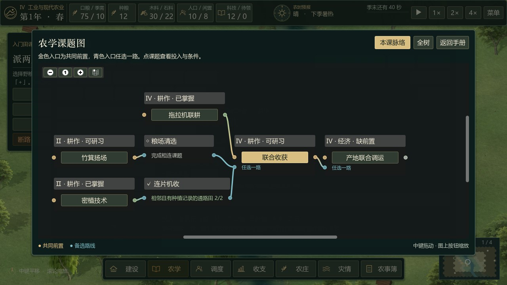

# 科技树整合试玩

四个时代共 73 项课题。按 **T** 后，可按「种源育种」「田间耕作」「水土防灾」「仓储流通」浏览。来源筛选能单独查看各作物、中国农技和当地农法。「仅看可研」列出当下能实际开题的研究。

## 走两条路，学会同一项技术

现代课题「联合收获」共同需要「拖拉机联耕」。接下来可按聚落已有的投入选择一路。

| 路线 | 还要满足的条件 | 适合怎样的聚落 |
| --- | --- | --- |
| 粮场清选 | 掌握「竹箕扬场」 | 已投资传统谷物加工，耕地较少 |
| 连片机收 | 掌握「密植技术」，同一圩区有两块相邻、已接路并在种或收获过的农田 | 先扩大耕地，再引入机械收割 |

任意一条达标即可按手册报价立项。开题后仍需 40 人秒和两次季末验收，每个有效季至少有 8 秒由农专教师和农田劳力同时到岗。开题所用的第二块田之后停工，已有进度仍然保留。

这些选择覆盖 27 项课题，包括六种作物各自的第二项田间技术。例如小麦可从「耧车条播」或「大田精耕」进入「条田匀播」。作物的发现、驯化和时代门槛仍然适用。课题图用金色标出共同前置，用青色标出备选路线。

## 六组合并课题

| 整合后研究一次即可掌握 | 合并的 V1.15 课题 | 收益 |
| --- | --- | --- |
| 大田精耕 | 深耕整地、大田管理 | 高地力田增产，单人值守的田块获得更多照料 |
| 农产集市 | 集市贸易、农产集售 | 降低木石买价，开放饲料出售 |
| 跨圩商运 | 商路开辟、长途商运 | 通路货运增加载量，新派货运与迁居行程缩短 |
| 仓廒分储 | 良种分仓、通风仓廒 | 有效粮仓同时增加口粮容量和独立种仓 |
| 秸秆与厩肥还田 | 秸秆还田、农牧还肥 | 谷物收获后恢复地力，有牧场时也能提高厩肥效力 |
| 田间试验教学 | 田间对照试验、农学师徒 | 对照秋收可取得待领札记，空闲农专编札更快 |

## 晋阶时的选择

| 从哪个时代晋阶 | 可选科技路线 | 口粮 |
| --- | --- | ---: |
| 早期农耕 | 修堤巡田（圩堤排水、田间巡查），或高仓备荒（简易防护、农产集市及安全粮仓） | 20 |
| 传统农耕 | 梯田轮作（等高筑田、谷豆轮作），轮作备荒（谷豆轮作、仓廒分储及有效二级粮仓），或依坡治水（等高筑田、分水闸门及有人值守的灌渠） | 32 |

仍需完成面板上的建设与生存条件，并由玩家支付口粮。现代战役最终合建中国农业大学。

## 继续旧战役

试玩版优先读取自己的存档。首次继续时可从同机 V1.15 存档接续，其次读取更早的兼容存档。旧版六组合并课题中，已掌握任一成员就取得整合后的完整效果。在研课题继承剩余工时与跨季进度。如果合并后的课题已经掌握，会直接腾出研究位置。物资和札记余额沿用原档。
